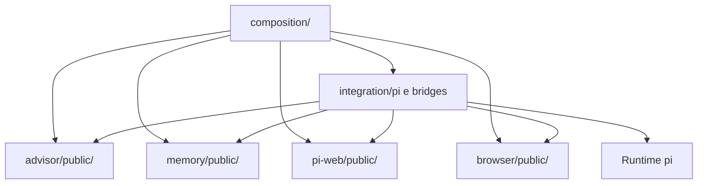

# Arquitetura do Synapse

Synapse contém quatro módulos: **memória**, **pi-web**, **navegador** e **advisor**. Cada módulo é uma unidade de propriedade de código, contratos e estado. A integração os conecta ao pi sem permitir dependências diretas entre eles.

## Padrão arquitetural

Adota-se **monólito modular com Portas e Adaptadores (arquitetura hexagonal)**, organizado verticalmente por módulo:

- **Monólito modular:** uma composição e uma distribuição como Pi package, sem exigir serviços independentes para separar responsabilidades. Processos auxiliares continuam sob o controle do módulo que os utiliza.
- **Organização vertical:** código, adaptadores e testes de uma capacidade ficam no diretório da frente responsável, em vez de distribuir as quatro frentes por pastas globais de controllers, services ou repositories. Isso reduz arquivos compartilhados durante mudanças paralelas.
- **Portas e Adaptadores:** cada módulo declara as operações externas de que necessita; a composição fornece implementações. Essa inversão de dependência permite desenvolver e testar uma frente sem carregar o pi ou a implementação das outras frentes.

A composição e a integração são infraestrutura de montagem, não um módulo de produto adicional. O pi permanece proprietário do loop do agente, das sessões, do histórico e da compactação.

## Fronteiras dos módulos

| Módulo | Responsabilidade e estado exclusivos | Contrato na fronteira |
| --- | --- | --- |
| Memória | Conhecimento persistido e seu controle de processamento, armazenamento e índices | Recebe conteúdo identificado e consultas com escopo; devolve resultados de memória com origem e estado da operação |
| pi-web | Interface, estado de apresentação e conexão com o runtime | Envia intenções por uma porta de runtime; recebe resultados e eventos para apresentação |
| Navegador | Contextos de navegação, execução de ações e artefatos associados | Recebe operação e identidade do alvo; devolve resultado, efeitos conhecidos e evidências |
| Advisor | Configuração, política de lembretes e consulta ao revisor | Expõe operações de configuração e consulta; distingue sucesso, falha e cancelamento |

Nenhum módulo lê ou escreve arquivos, tabelas, caches ou estado mutável privado de outro. Configuração é entregue separadamente a cada módulo; não existe acesso à configuração privada de um vizinho. Compartilhar o processo não torna esses dados públicos.

## Estrutura de diretórios

Estrutura alvo do código. Cada ocorrência de `<modulo>` corresponde a `memory`, `pi-web`, `browser` ou `advisor`.

| Caminho | Conteúdo e propriedade |
| --- | --- |
| `src/modules/memory/` | Área exclusiva da frente de memória |
| `src/modules/pi-web/` | Área exclusiva da frente de pi-web |
| `src/modules/browser/` | Área exclusiva da frente de navegador |
| `src/modules/advisor/` | Área exclusiva da frente de advisor |
| `src/modules/<modulo>/public/` | Contratos de entrada e saída, portas requeridas e ponto público de montagem do módulo |
| `src/modules/<modulo>/internal/` | Núcleo privado de regras e casos de uso; a organização interna pertence à frente |
| `src/modules/<modulo>/adapters/` | Adaptadores privados de entrada e saída: interface, armazenamento, provedores e engine, conforme o módulo |
| `src/modules/<modulo>/tests/` | Testes isolados do módulo e substitutos de suas portas |
| `src/integration/pi/` | Adaptação ao SDK, eventos e registros do host |
| `src/integration/bridges/` | Adaptadores que conectam a porta de um módulo ao contrato público de outro |
| `src/composition/` | Montagem, injeção de dependências, distribuição da configuração e encerramento |
| `src/entry.ts` | Entrada do pacote Pi que aciona a composição |
| `tests/integration/` | Verificação dos contratos conectados e da integração com o host |
| `tests/fixtures/` | Substitutos e dados usados nos testes de integração |

`public/` separa contratos sem dependências concretas do ponto de montagem que instancia a implementação privada. A composição usa esse ponto para obter a interface do módulo; não importa `internal/` nem `adapters/`. Não há uma pasta compartilhada de regras de negócio.

## Dependências permitidas

As setas representam dependências de código, não ordem de execução.

1. **Não há imports entre módulos, nem de contratos públicos.** A consumidora define sua própria porta; uma bridge implementa essa porta usando a interface pública da produtora. A composição injeta a bridge.
2. **Em produção, somente composição e integração acessam módulos de fora**, sempre por `public/`. Nenhum módulo importa composição ou integração. Testes de integração também se limitam à superfície pública.
3. **O núcleo depende de contratos e portas, não de adaptadores.** O SDK do pi fica em `integration/pi/`; SDKs de provedores e engines ficam nos adaptadores do módulo responsável. Objetos desses SDKs não atravessam os contratos.
4. **Bridges traduzem, não decidem.** Adaptam dados e chamadas entre contratos; não movem regras de um módulo para a integração nem fazem a consumidora adotar os tipos privados da produtora.
5. **Não existem atalhos de comunicação:** leitura de armazenamento alheio, singletons mutáveis compartilhados e barramentos globais sem contratos são proibidos. Eventos, quando necessários, integram a superfície pública e têm assinatura e origem explícitas.

Assim, uma funcionalidade do pi-web que necessite de memória depende de uma porta do próprio pi-web. A bridge chama a memória e traduz sua resposta; a implementação da interface não importa nem precisa executar o módulo de memória em seus testes.

## Contratos de integração

- **Superfície pública:** define operações, entradas, saídas e portas exigidas. Dados transferidos são valores independentes de banco, framework e SDK; contratos não expõem entidades mutáveis ou handles internos.
- **Contexto explícito:** cada operação recebe as identidades e os escopos de que necessita. Não resolve sua origem consultando uma sessão global que pode mudar durante uma chamada assíncrona.
- **Resultado explícito:** o contrato distingue sucesso, falha, confirmação pendente e conclusão desconhecida quando aplicáveis, incluindo efeitos parciais. Cancelamento ou timeout não equivalem a ausência de efeito.
- **Ciclo de vida:** a montagem recebe dependências e configuração e devolve a interface operacional e o mecanismo de encerramento. Cada módulo libera os recursos que criou; a composição coordena o encerramento sem acessar detalhes privados.
- **Evolução:** cada frente controla seus contratos públicos. Alterações compatíveis preservam consumidores existentes; uma alteração incompatível exige migração coordenada das bridges e consumidores afetados, sem depender de mudanças simultâneas nas implementações privadas.

A entrada do Pi package, declarada em `pi.extensions`, aciona a composição. A integração com o host registra as capacidades resultantes. Ela não replica regras dos módulos nem transforma persistência própria em histórico autoritativo do pi.

## Automação do repositório

`.github/` contém infraestrutura de desenvolvimento, não um módulo de produto. A avaliação automática de PR (`.github/pr-evaluator/`) é composta por capacidades com dependências em um só sentido; cada pasta tem uma responsabilidade que seu nome revela:

| Pasta | Responsabilidade |
| --- | --- |
| `configuration/` | Ler e validar as variáveis de ambiente |
| `diff-reading/` | Obter o diff do git, com um limite de leitura explícito |
| `source-reading/` | Ler os arquivos de código do commit avaliado, com um limite de leitura explícito |
| `diff-annotation/` | Numerar as linhas do diff e registrar as que ele mostra, com a posição de cada uma |
| `review-request/` | Carregar arquitetura, regras e padrões e montar a solicitação ao avaliador |
| `http-failure/` | Recusar uma resposta HTTP que falhou, com o status e o detalhe dela, para os dois clientes HTTP |
| `provider-client/` | Chamar o modelo no provedor, ler a resposta em streaming e repetir a chamada em falhas de servidor |
| `review-result/` | Validar a resposta: veredito e apontamentos |
| `github-rest-client/` | Chamar a API REST do GitHub e esperar o limite de taxa |
| `finding-placement/` | Posicionar cada apontamento na linha do diff e agrupar os da mesma linha |
| `review-text/` | Escrever o texto da review: o comentário de cada apontamento, o resumo, o marcador do commit e a seção dos apontamentos sem linha |
| `pull-request-review/` | Consultar a PR, ler as reviews já publicadas e publicar a review, com um comentário por grupo de apontamentos |
| `evaluation/` | Coordenar os passos de uma avaliação; nenhuma outra capacidade o importa |

O modelo usado é fixo no workflow. A automação não tem testes unitários: é verificada ao executá-la no GitHub Actions.

## Desenvolvimento paralelo e proteção das fronteiras

- Cada frente modifica seu diretório `src/modules/<modulo>/` e valida o módulo isoladamente, substituindo portas externas por implementações de teste.
- Para cada mudança que atravesse fronteiras, uma das frentes assume a integração. Esse responsável concentra alterações em `src/integration/`, `src/composition/`, `tests/integration/` e manifestos, lockfiles e configurações da raiz; esses arquivos não recebem escrita concorrente das frentes.
- As bridges são testadas contra os contratos da consumidora e da produtora, permitindo trocar uma implementação sem adaptar a outra frente.
- A verificação de dependências rejeita imports entre módulos, acesso externo a diretórios privados, dependência do núcleo em adaptadores e uso do SDK do pi fora da integração. Os testes de contrato verificam as fronteiras públicas; testes do host verificam a montagem e o ciclo de vida.
