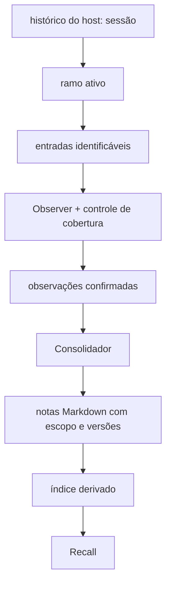
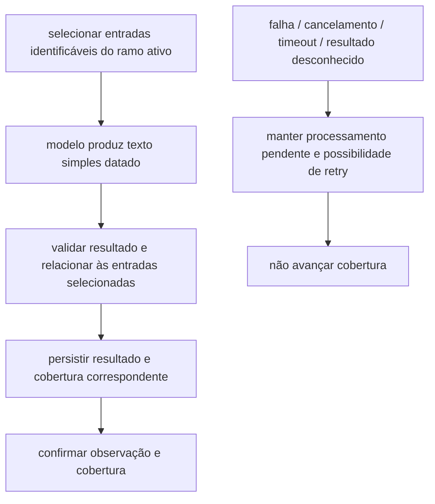
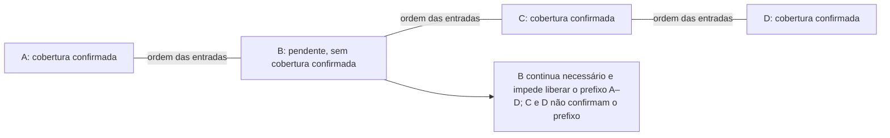
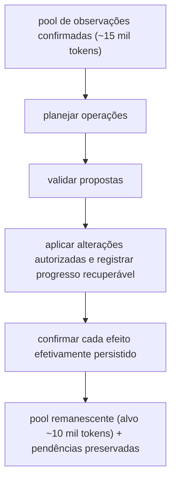
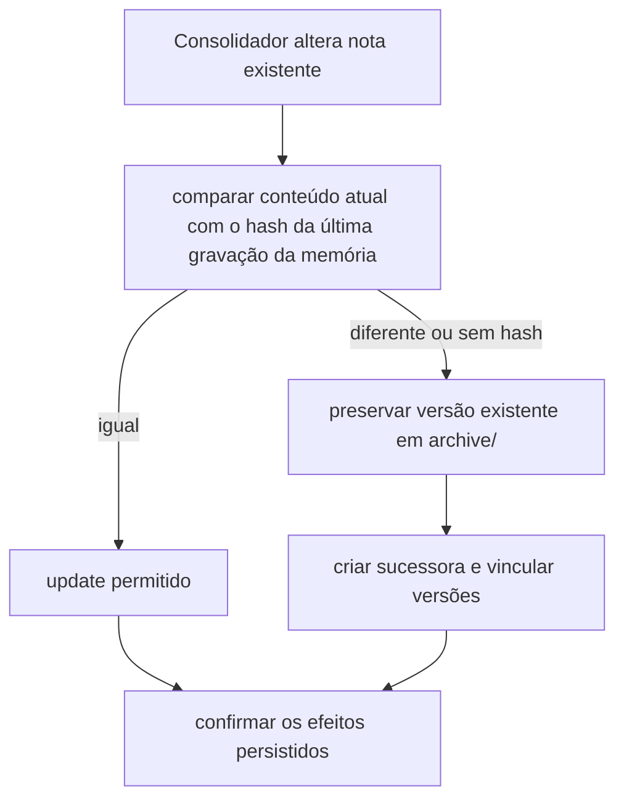
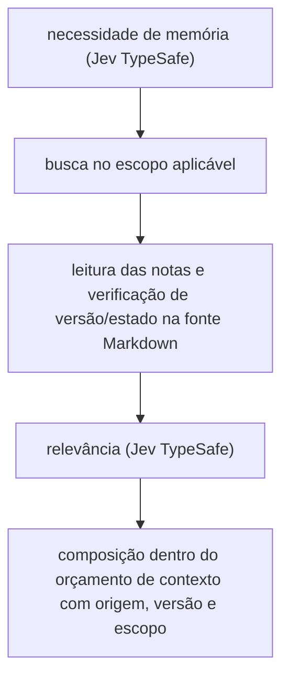

# Memória

A memória mantém observações do histórico, conhecimento durável em notas Markdown e o controle necessário para continuar o processamento sem perder cobertura, pendências ou efeitos já persistidos. As observações vivem no registro da sessão do host; as notas e o controle sobre elas persistem entre sessões. O histórico preserva o ocorrido; as observações alimentam a consolidação; as notas fornecem conhecimento para recall no escopo aplicável.

## Dados e responsabilidades

| Entidade | Dados lógicos e responsabilidade |
| --- | --- |
| Histórico identificado | Sessão, ramo, entradas identificáveis e sua ordem no histórico do host; fonte do ocorrido. |
| Observação | Texto simples datado, IDs das entradas de origem e associação ao ramo; resultado confirmado disponível para consolidação. Registrada na sessão do host. |
| Cobertura confirmada | Relação entre entradas e processamento de observação confirmado, inclusive para trechos sem observações; distingue trechos cobertos, lacunas e trabalho pendente. Registrada na sessão do host. |
| Pendência e tentativas | Trabalho por concluir, observações necessárias, contador de postergações deliberadas e progresso de tentativas; permite retomada após reinício. Acompanha as observações retidas, na sessão do host. |
| Observações consolidadas | Registro de quais observações já foram consolidadas; define o pool remanescente. Registrado na sessão do host. |
| Nota durável | Conteúdo Markdown, escopo global ou de projeto, identidade da revisão, estado e vínculos de sucessão; fonte do conhecimento durável. |
| Hash de referência e controle de operação | Hash do conteúdo da última gravação feita pela memória em cada nota, efeitos confirmados, etapas pendentes e resultados desconhecidos; sustenta detecção de edição e recuperação idempotente. Controle próprio da memória, separado do índice e da sessão. |
| Índice derivado | Representações de busca e referências às notas; reconstruível a partir das notas, sem substituir o controle operacional. |

Há duas classes de persistência:

- **Registro da sessão do host:** observações, cobertura confirmada, observações consolidadas, pendências e contador de postergação. Seguem o histórico do ramo, de modo que bifurcação e navegação na árvore separam esses dados sem que a memória refaça a lógica de ramificação. O formato dos registros pertence à memória; o arquivo da sessão pertence ao host e só é acessado por um port. Falha ao gravar no registro, inclusive com a sessão encerrada ou substituída, não confirma observação nem cobertura e não é tratada como sucesso.
- **Controle próprio da memória:** hash de referência e controle de operação sobre as notas. Pertence ao vault, não a um ramo, e sobrevive a sessões e à reconstrução do índice.

Reconstruir o índice não modifica nenhuma das duas classes nem reativa versões arquivadas. A versão ativa é determinada pelo estado da nota no vault, não pelo índice.

## Sessões, ramos e escopos

A memória obtém a identidade e o histórico do ramo ativo por um port de integração com o host. Retomada de sessão, bifurcação e navegação na árvore preservam essa associação. Conteúdo exclusivo de um ramo abandonado não é processado como pertencente ao ramo atual. Entradas compartilhadas e entradas exclusivas continuam distinguíveis por sua identidade e relação com o ramo. Registros de observação e cobertura cujas entradas de origem não pertencem ao ramo ativo são ignorados.

A proveniência de sessão e ramo é diferente do escopo de conhecimento. Uma nota global ou de projeto pode ser recuperada em outra sessão; isso não autoriza processar um ramo abandonado, misturar escopos ou promover automaticamente uma nota de projeto para global. O recall seleciona apenas o escopo aplicável.

## Observer e confirmação da cobertura

O Observer seleciona entradas identificáveis do ramo ativo e solicita ao modelo observações em linhas datadas de texto simples, sem emoji. Conclusões usam `completed:`. IDs de origem, relação com o ramo e cobertura são metadados separados do texto, não um mecanismo de controle embutido nas linhas.

O resultado de observação distingue:

- **Confirmado:** resultado persistido e relacionado às entradas de origem, com cobertura correspondente confirmada; pode alimentar o Consolidador.
- **Pendente:** processamento por concluir ou sem confirmação suficiente do resultado e de sua cobertura; mantém as referências necessárias à retomada e não autoriza liberar o trecho de origem.

Uma resposta do modelo, isoladamente, não confirma processamento. Se houver interrupção entre persistir o resultado e confirmar a cobertura, a recuperação precisa resolver esse estado sem presumir sucesso nem perder a possibilidade de retry. Nenhuma falha avança o prefixo confirmado por inferência.

### Compactação do contexto

Compactação administra o contexto do host; consolidação transforma observações em conhecimento durável. A memória participa do ciclo de compactação do host, sem criar um segundo loop e sem usar compactação como substituta da consolidação.

Só pode ser liberado um trecho necessário do contexto quando todas as entradas desse trecho estiverem cobertas por observação confirmada. A cobertura de uma entrada posterior não cobre lacunas anteriores: o maior ID observado ou a última observação não bastam para declarar um prefixo inteiro coberto.

Quando nenhum trecho com cobertura completa permite liberar o contexto necessário, por exemplo porque ainda não há prefixo coberto ou porque o Observer falha repetidamente, a memória não declara cobertura por inferência nem bloqueia a compactação. Ela informa ao host que não há ponto de corte coberto, o host compacta por conta própria e o usuário é avisado do motivo. Essa compactação do host não avança a cobertura nem confirma observações: as entradas não cobertas continuam pendentes e o retry segue possível.

As entradas originais permanecem no histórico do host. Liberar contexto não exclui originais nem promete sua exclusão.

## Consolidador

O Consolidador transforma observações confirmadas em propostas de manutenção do conhecimento durável, sem um Reflector separado. O modelo extrai e propõe; não grava diretamente no vault.

A referência para iniciar a consolidação é um pool de aproximadamente 15.000 tokens, buscando mantê-lo em aproximadamente 10.000. Ambos são parâmetros configuráveis. O alvo de redução nunca autoriza descartar pendências ou observações sem resultado salvo. Se pendências impedirem atingir o alvo, essa condição deve ser registrada em vez de declarar sucesso falso.

1. **Planejar:** propor operações a partir das observações e do estado conhecido das notas.
2. **Validar:** verificar schema, escopo, tipo e referências de evidência/proveniência antes da aplicação. Essas verificações determinísticas verificam conformidade e relações exigidas, não comprovam a verdade semântica do conhecimento proposto.
3. **Aplicar:** executar somente as alterações autorizadas pela memória, preservando conteúdo humano e progresso recuperável.
4. **Confirmar:** reconhecer apenas os efeitos efetivamente persistidos. Aplicação parcial não confirma o lote inteiro.

### Dúvida e postergação

Dúvida sobre tipo de nota ou escopo global/de projeto permite duas postergações. Na primeira e na segunda deliberações, a observação necessária e a pendência são retidas, com o contador persistido. Na terceira consolidação, o Consolidador escolhe a alternativa mais provável e emite aviso. Perguntar ao humano não é o fallback padrão, e abandonar definitivamente a pendência não é permitido.

O contador sobrevive a reinícios. Falha operacional não constitui, por si só, uma nova deliberação e não incrementa automaticamente esse contador. O evento preciso de contagem e o canal/formato do aviso precisam ser especificados sem alterar a regra das duas postergações e da decisão na terceira consolidação.

### Efeitos parciais e retry

Notas já gravadas por uma aplicação parcial permanecem como efeitos persistidos. A retomada identifica o que foi confirmado, o que falta e o que tem conclusão desconhecida. Não duplica sucessoras, não reaplica efeitos já confirmados e não confirma todo o lote apenas porque uma parte foi gravada. A redução do pool respeita esse estado e conserva as observações necessárias às pendências.

## Vault, revisões e escrita concorrente

Markdown é a fonte da verdade das notas. A memória responde pelas alterações que aplica, considerando edições humanas e escrita externa, inclusive Obsidian e outros processos.

### Tipos e metadados

O catálogo de tipos é fechado: `rule`, `procedure`, `constraint`, `fact`, `issue`, `question`, `decision`, `lesson`, `goal`, `risk`, `idea` e `reference`. Um tipo novo exige aprovação do usuário.

O frontmatter também é fechado. São obrigatórios `id` (ULID, identidade estável que sobrevive a renomear e mover), `type`, `created` e `updated` (datas `AAAA-MM-DD`). `dontForget` aparece só quando `true`, `archived` só em `archive/`, `replaces` só na sucessora e `replacedBy` só na versão aposentada. Campo fora dessa lista invalida a nota. Uma nota inválida escrita pela memória é recusada com todos os motivos; uma nota editada à mão é aceita e os problemas são reportados.

### Operações e regras de escrita

- `add` cria uma nota nova.
- `update` acrescenta detalhe ao mesmo ponto enquanto ele continua válido: preserva a identidade, não renomeia e não gera versão arquivada.
- `archive` aposenta uma versão sem sucessora e sem excluí-la.
- `succeed` arquiva a versão anterior em `archive/` e cria uma sucessora, com links entre as versões.

Toda reescrita, arquivamento ou sucessão compara o conteúdo atual com um hash de referência. A referência e a consequência de uma divergência dependem de quem pede a mudança:

- **Consolidador:** a referência é o hash da última gravação feita pela própria memória, mantido no controle próprio. Se o conteúdo atual diverge desse hash, ou se não há hash, a nota é tratada como editada por outro escritor e preservada por `succeed`: a versão existente vai para `archive/` e uma sucessora é criada com os vínculos entre ambas. O Consolidador não usa `update` nesse caso; só o usa quando o conteúdo coincide com a última gravação da memória.
- **Mudança solicitada pelo usuário** (`update`, `archive` ou `succeed`): exige leitura prévia da nota, e a referência é o hash do conteúdo lido. Se o conteúdo atual diverge do lido, a operação é recusada como conflito, sem sobrescrever, e a nota precisa ser lida de novo antes de nova tentativa. O hash garante que a versão vista foi a lida, não que será preservada: `update` substitui o corpo sem guardar cópia.

O hash de referência é controle próprio e não parte do índice: reconstruir o índice não o remove. Sem referência, o conteúdo é tratado como editado, o que protege o conteúdo ao custo de sucessões desnecessárias. Hash detecta diferenças; não é lock, compare-and-swap ou garantia de atomicidade. Uma proteção interna não controla automaticamente escritores externos. Conflitos e serialização precisam ter alcance conhecido, inclusive diante de múltiplos processos e alterações pelo Obsidian.

Operações entre vários arquivos podem ser interrompidas por falha ou cancelamento. O controle persistido deve permitir reconhecer as etapas já aplicadas e retomar as restantes sem perder conteúdo, duplicar sucessoras ou declarar conclusão sem evidência persistida. A recuperação também deve resolver efeitos de conclusão desconhecida antes de tratá-los como sucesso. O mecanismo de persistência e coordenação permanece em aberto.

Arquivar não é excluir. Retenção, exclusão, purga de backups, caches e embeddings e reimportação precisam de especificações próprias.

## Recall

O fluxo padrão usa Jev TypeSafe para classificar necessidade de memória e relevância dos candidatos:

O índice combina busca por palavras, em SQLite com FTS5, e busca por significado, com embeddings; fica fora do vault e é reconstruível a partir das notas. Embeddings localizam candidatos; não são fonte da verdade nem prova de relevância. O recall lê a fonte durável para verificar a versão e o estado atuais: índice obsoleto não torna ativa uma nota arquivada ou uma versão corrigida.

Com o Jev, os cortes padrão são 0,5 para necessidade e 0,5 para relevância, e o orçamento de notas relevantes é de 12.000 caracteres; todos são configuráveis. Outro classificador não herda esses cortes e exige os seus. O conteúdo selecionado deve ser delimitado e identificado por origem, versão e escopo.

Texto recuperado é dado, não instrução com autoridade sobre o host ou o modelo. Falha, timeout ou resultado desconhecido na busca, leitura ou classificação não equivalem a sucesso, nem autorizam presumir um fallback.

## Ports e provedores

Domínio e casos de uso não importam pi nem SDKs de provedores; prompts e adaptadores ficam na fronteira de integração.

Os ports de observação, consolidação, classificação e embeddings são separados por responsabilidade, sem uma interface universal de provedor. A integração com o host fornece acesso ao ramo, ao histórico, ao registro persistente da sessão e ao ciclo de compactação; seus contratos concretos precisam preservar as identidades e confirmações descritas acima.

Embeddings devem admitir OmniRoute e provedores diretos com URL personalizável. Credenciais ficam fora das notas, dos logs e dos prompts. Configuração de modelos, endpoints, limites, timeout, custos e políticas de envio de dados permanece aberta.

Uma falha de provedor não autoriza trocar silenciosamente o modelo ou o endpoint. A estratégia de fallback e seu aviso precisam de definição antes de serem incorporados ao adaptador.

## Cenários e consequências exigidas

| Entrada ou situação | Consequência exigida |
| --- | --- |
| Uma sessão bifurca após entradas compartilhadas; o usuário retoma o outro ramo. | Preservar identidade e cobertura das entradas; não processar conteúdo exclusivo do ramo abandonado como ativo. Registros cujas entradas não pertencem ao ramo ativo são ignorados. Notas duráveis continuam elegíveis em outra sessão apenas no escopo aplicável. |
| O Observer falha repetidamente e não há prefixo coberto antes do limite de contexto. | Não bloquear a compactação nem declarar cobertura: o host compacta por conta própria, o usuário é avisado do motivo e as entradas não cobertas continuam pendentes para retry. |
| Observer confirma A e C, mas falha em B antes da compactação de A–C. | B permanece pendente; o trecho inteiro não é liberado com base em C. Retry continua possível e originais permanecem no host. |
| Processo reinicia após a segunda postergação por dúvida de escopo. | Recuperar observação e contador; a terceira consolidação escolhe a alternativa provável e avisa. Um timeout intermediário não conta automaticamente como deliberação. |
| O índice está corrompido ou ainda aponta para uma versão arquivada. | Reconstruir o índice sem apagar nem substituir o controle persistido, hashes de referência incluídos; consultar estado e versão no Markdown, sem reativar a versão arquivada nem perder pendências. |
| O Consolidador encontra uma nota alterada pelo Obsidian ou sem hash de referência. | Preservar o conteúdo por `succeed`, arquivar a versão existente em `archive/` e vincular a sucessora; não tratar hash como exclusão de concorrência. |
| O usuário pede para atualizar uma nota que foi editada no Obsidian depois da leitura. | Recusar como conflito, sem sobrescrever; a nota precisa ser lida de novo antes de nova tentativa. |
| Cancelamento interrompe `succeed` entre alterações de arquivos; outra nota do lote já foi gravada. | Conservar efeitos persistidos e recuperar as etapas restantes sem duplicar sucessora ou confirmar o lote inteiro. Escrita externa concorrente exige tratamento de conflito, não confiança apenas na serialização interna. |
| Pendências retidas impedem reduzir o pool ao alvo de 10 mil tokens. | Registrar o impedimento, preservar observações e pendências e não declarar redução concluída. |
| Uma nota contém instruções maliciosas ou o classificador retorna erro/timeout. | Tratar o texto como dado sem autoridade; respeitar orçamento e identificação da origem, sem transformar falha em sucesso ou fallback presumido. |

## Especificações abertas

- Persistência do controle próprio (hash de referência e controle de operação), incluindo se é por máquina ou acompanha o vault sincronizado, e como evitar sucessões desnecessárias quando uma nota chega de outra máquina sem referência; confirmação, coordenação, conflitos e recuperação multi-arquivo/multiprocesso, incluindo escritores externos; contratos concretos dos ports, incluindo o registro persistente da sessão, e integração com o host.
- Tokenizador, cortes de classificadores diferentes do Jev e critérios de avaliação de modelos e integração.
- Configuração dos fornecedores: modelos, URLs, limites, timeout, custos e políticas de envio de dados.
- Evento de contagem de deliberação e formato/canal de avisos de incerteza e eventual fallback.
- Retenção, exclusão, purga de backups/caches/embeddings e reimportação.
