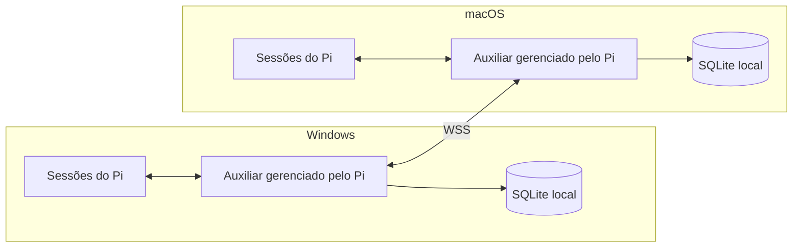
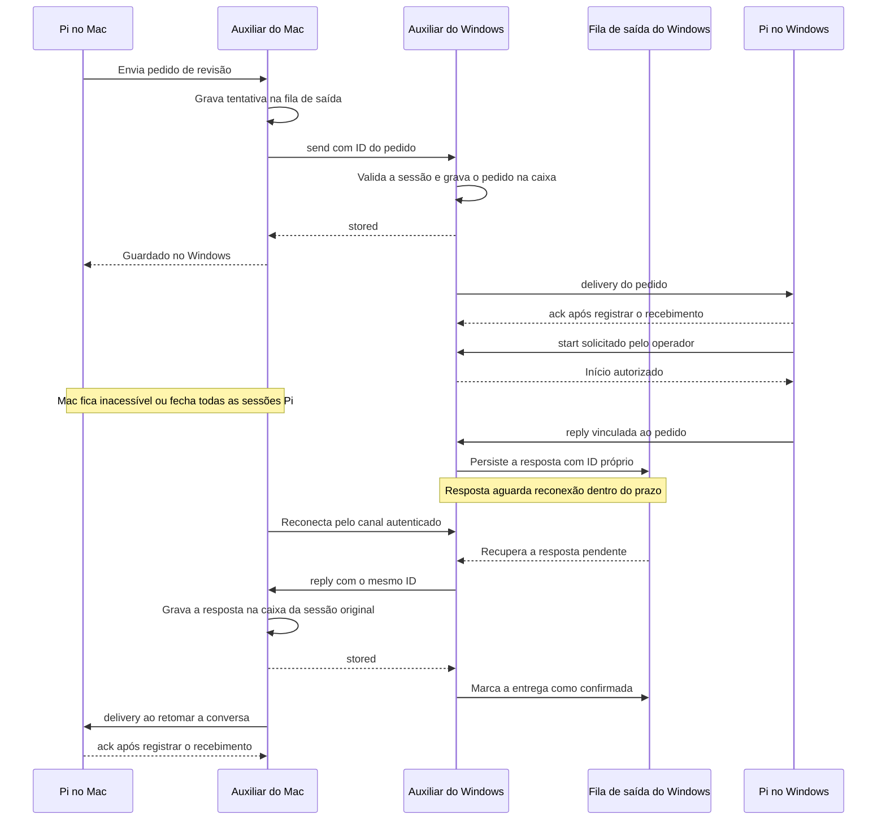

# Mensageria

A mensageria conecta sessões interativas do Pi no Windows e no macOS. Cada instalação hospeda as caixas das próprias conversas e descobre outros Synapses nas redes disponíveis. Um agente pode localizar outra sessão, enviar um pedido e receber a resposta após uma desconexão.

## Dados e responsabilidades

A mensageria seria um módulo do Pi package, seguindo as portas e adaptadores da [arquitetura do Synapse](architecture.md). Ao abrir o primeiro Pi, a extensão inicia um supervisor local do próprio Pi package. Ele gerencia o auxiliar que mantém o endpoint da instalação. As outras sessões reutilizam a instância e cada conversa se registra automaticamente ao abrir. Se o auxiliar cair ou travar, o supervisor tenta substituí-lo na mesma porta. Uma sessão saudável pode iniciar um novo supervisor se o anterior sair. Os auxiliares se descobrem nas redes disponíveis e trocam mensagens diretamente por WebSocket seguro. Cada instalação guarda em SQLite suas caixas e a fila de saída. O Pi continua responsável pela sessão, pelo histórico e pelo loop do agente.

## Inicialização e recuperação do auxiliar

O Pi package distribui um auxiliar local por instalação. Em `session_start`, a extensão conecta ao auxiliar, inicia-o se necessário e registra a conversa. As extensões iniciam e reutilizam um único supervisor local distribuído no Pi package. O supervisor cria o auxiliar e conserva a referência à instância que criou. As sessões monitoram a saúde e podem solicitar recuperação pela interface local. O auxiliar possui o endpoint de rede e acessa o SQLite da instalação. Se a última sessão fechar, o auxiliar encerra após persistir o estado. Ao abrir qualquer Pi, a extensão recupera o auxiliar, as caixas e a fila.

1. **Partida exclusiva.** A extensão tenta conectar ao auxiliar e faz uma consulta de saúde com prazo. Se falhar, disputa o bloqueio local de inicialização e recuperação. A vencedora testa a saúde de novo sob o bloqueio, pois outra sessão pode ter resolvido a falha. Só a vencedora pode iniciar o supervisor. O supervisor mantém a exclusividade enquanto estiver ativo e serializa os pedidos de recuperação do auxiliar. As demais sessões aguardam e tentam conectar com espera progressiva.
2. **Substituição segura.** Se o auxiliar estiver travado, o supervisor só pode encerrá-lo após confirmar, por identidade de processo validada pelo sistema, que se trata da instância criada pelo Synapse. Porta e PID salvos, isoladamente, são insuficientes. O supervisor aguarda a saída antes de iniciar o substituto na mesma porta. Se a identidade for incerta, a porta pertencer a outro programa ou o encerramento falhar, a supervisão sinaliza o endpoint indisponível e mantém a fila em disco. Não procura outra porta nem encerra um processo de identidade incerta. Tenta a mesma porta com espera progressiva. Quando conseguir reabrir o endpoint, retoma os itens ainda válidos pelos mesmos IDs. O protótipo deve validar um mutex nomeado e um handle de processo no Windows, e um bloqueio exclusivo de arquivo e supervisão do filho direto no macOS. Se o supervisor sair e a porta estiver livre, uma sessão ativa pode iniciar outro. Se o supervisor continuar travado com o bloqueio, ou se a porta continuar presa a uma instância cuja identidade o novo supervisor não consegue comprovar, a fila permanece em disco e a recuperação espera a liberação do recurso.
3. **Retomada.** O substituto reabre o SQLite, recupera a fila e retoma a descoberta. As extensões se reconectam e registram novamente suas sessões. O auxiliar retira a presença de sessões locais que param de responder. A recuperação do transporte reaproveita os IDs de mensagem. A máquina destinatária confirma apenas gravações concluídas.
4. **Falhas persistentes.** Sem Pi saudável, a próxima abertura de uma sessão retoma a supervisão. Rede indisponível e armazenamento sem acesso mantêm a entrega pendente ou sem confirmação. O auxiliar tenta novamente quando a condição volta ao normal, dentro dos prazos de entrega. Se a única cópia persistente for perdida, a recuperação depende de uma cópia adicional.

## Descoberta, confiança e presença

- Após a habilitação, o processo executa em paralelo os mecanismos de descoberta disponíveis. Nas interfaces locais elegíveis, anuncia e procura serviços por mDNS/DNS-SD. Para a tailnet, o auxiliar consulta em modo de leitura os endereços dos dispositivos visíveis ao cliente Tailscale local. A descoberta testa o endpoint WSS do Synapse diretamente nesses endereços, na porta TCP conhecida do protocolo. Nomes de conversas, conteúdo e credenciais circulam apenas entre pares autorizados. [mDNS](https://www.rfc-editor.org/rfc/rfc6762.html) · [DNS-SD](https://www.rfc-editor.org/rfc/rfc6763.html) · [Pares no cliente Tailscale](https://github.com/tailscale/tailscale/blob/main/ipn/ipnstate/ipnstate.go)
- No primeiro pareamento, o operador verifica a identidade apresentada pelo outro computador antes de autorizar o vínculo. A identidade criptográfica persistente fica associada ao ID da instalação e é verificada nas conexões WSS seguintes. O processo agrupa os endereços pela identidade autenticada do par. Se o caminho ativo cair, tenta os demais sem alterar os IDs da caixa ou das mensagens. Uma chave diferente exige novo pareamento. O mecanismo de provisionamento e validação das chaves será fechado na implementação.
- A extensão registra automaticamente a sessão no auxiliar local gerenciado pelo Pi em `session_start` e encerra o registro em `session_shutdown`. Ao reconectar ao processo local, registra de novo a sessão atual. O registro inclui os metadados já conhecidos, como nome da sessão e repositório identificado. Função, PR e rótulos são opcionais. O endereço da caixa é o par `installationId` e `sessionId`. O ID da sessão vem de `ctx.sessionManager.getSessionId()`. Uma conexão local é titular do consumo por sessão. O encerramento da conexão local também retira a presença do titular. O endereço existe desde o registro. A primeira gravação de mensagem cria a caixa persistente. [API e eventos do Pi](https://pi.dev/docs/latest/extensions#session-events)
- Cada par mantém um canal autenticado com o outro. Se houver conexões simultâneas, os dois lados usam a mesma regra de desempate baseada nos IDs das instalações para manter uma conexão lógica. Um encerramento atrasado só invalida a presença da conexão encerrada. O canal inicia com um retrato da presença local, seguido por eventos ordenados. Ao cair, as sessões do par saem da busca. Ao reconectar, um novo retrato substitui o anterior. O Ping/Pong do WebSocket detecta quedas silenciosas. [Ping/Pong do WebSocket](https://www.rfc-editor.org/rfc/rfc6455.html#section-5.5.2)

### Conexão direta pela tailnet

A porta do protocolo é a mesma para todos os pares e seu número será definido na implementação. O auxiliar escuta nos endereços elegíveis da instalação, incluindo a interface Tailscale quando disponível. A rede precisa permitir a conexão TCP entre os dispositivos. O pareamento e a verificação da identidade continuam no protocolo Synapse. O MVP usa o cliente Tailscale instalado para conectividade e leitura dos candidatos. Integração com `tsnet`, Tailscale Serve e alteração da configuração do cliente ficam fora do escopo.

### Descoberta e reconexão em outras VPNs

Os mecanismos de descoberta fornecem candidatos ao mesmo processo de conexão. Uma VPN com multicast pode usar mDNS. Redes que oferecem registros DNS-SD podem usar consulta DNS unicast. Uma integração com o cliente da VPN pode obter sua lista de dispositivos. O MVP usa LAN e Tailscale como caminhos de referência. Uma rede que só fornece rotas permite tentar candidatos já conhecidos. A primeira descoberta de um par nessa rede depende de uma fonte de candidatos fornecida pela própria rede. [DNS-SD](https://www.rfc-editor.org/rfc/rfc6763.html)

Depois de autenticar o par, os processos trocam seus endpoints de escuta elegíveis. O destinatário guarda os candidatos por identidade do par e volta a validá-los na reconexão. Um endereço aprendido pode estar desatualizado ou apontar para outra máquina em redes com faixas IP sobrepostas. O processo só considera a reconexão concluída quando o endpoint apresenta a identidade já aprovada. Endereços alternativos circulam apenas entre pares autorizados.

Testar com o Mac e o Windows pareados pela LAN e uma segunda VPN ativa. Após a troca de endpoints, desligar o caminho da LAN e confirmar a reconexão automática pela VPN, com entrega do item pendente pelo mesmo ID. Repetir com um endereço desatualizado ou reutilizado por outra máquina e verificar que a fila continua pendente enquanto nenhum caminho autenticado estiver disponível.

### Seleção de conversas

O diretório aproveita nome da conversa, repositório, função e PR quando conhecidos. Rótulos manuais são opcionais. `/peer list` e `peer_find` mostram as conversas alcançáveis. Para “fala com a revisão da PR no Windows”, o agente filtra por máquina, função e contexto da PR. Se houver várias correspondências ou os dados forem insuficientes, pede a escolha antes de enviar ao ID estável.

Retomar a mesma conversa recupera sua caixa. Uma conversa nova recebe outro endereço. [Formato de sessão do Pi](https://pi.dev/docs/latest/session-format)

## Protocolo entre máquinas

Frames JSON incluem `v: 1` e `type`. Requisições incluem `requestId`, repetido no resultado. O `messageId` é estável entre tentativas e é gerado antes da primeira gravação na fila de saída. A chave de deduplicação no destino combina a identidade autenticada da instalação de origem com o ID da mensagem. As sessões de origem e destino são campos do envelope. O receptor vincula a instalação de origem à identidade autenticada e verifica que a caixa de destino pertence à instalação local.

| Operação | Dados e efeito |
| --- | --- |
| `presence_snapshot`, `presence_changed` | Sessões ativas autorizadas e seus metadados. O retrato e os eventos têm escopo da conexão atual. |
| `send` | ID, sessão de origem, caixa de destino, corpo, referências opcionais de repositório, PR e commit, e prazo opcional da tarefa. O destino revalida presença antes de aceitar um pedido novo. |
| `reply` | ID próprio, referência ao pedido original e corpo. A origem da resposta deve ser a sessão que recebeu o pedido original. A caixa de retorno é a do pedido original e pode estar sem terminal ativo. |
| `stored` | Resultado de `send` ou `reply`. Confirma a transação na caixa da máquina de destino. Uma repetição com o mesmo ID e conteúdo devolve o resultado conhecido. Mesmo ID com conteúdo ou destino diferente retorna `message_id_conflict`. |
| `status` | Consulta o estado pelo ID após uma confirmação incerta. Acesso restrito aos participantes autorizados. |
| `cancel` | Solicita cancelamento de um pedido já guardado. O destino responde com o resultado da transição ou informa que o trabalho já iniciou. Uma queda antes da resposta deixa o cancelamento sem confirmação. |

Na interface local, a extensão chama `register` automaticamente para vincular a sessão do Pi ao endereço da caixa. O processo usa `delivery` para entregar uma mensagem, e a extensão usa `ack` para confirmar o recebimento. `start` solicita o início da tarefa e é arbitrado pelo processo que hospeda a caixa. O serviço persiste os estados e só permite as operações locais ao titular da sessão.

## Persistência e confirmações

1. **Na fila de saída.** O processo de origem grava a mensagem e seu ID em SQLite antes de transmiti-la. Um pedido novo exige um destino conhecido como ativo. Uma resposta vinculada pode entrar na fila com o par offline. O estado da fila local indica **aguardando envio** ou **entrega não confirmada** conforme já tenha havido tentativa.
2. **Guardado no destino.** O processo destinatário grava a mensagem e a chave de deduplicação na mesma transação. Só então responde `stored`. A origem persiste esse resultado antes de concluir a fila de saída. O destino consulta a deduplicação antes de revalidar a presença. Assim, repetir um pedido já aceito funciona mesmo que seu terminal tenha fechado.
3. **Recebido pelo Pi.** A extensão confirma depois de registrar o recebimento de forma durável e idempotente pelo ID. O processo local persiste o recibo e pode comunicá-lo ao remetente ao reconectar. Se a extensão cair entre a gravação e a confirmação, a reentrega reconhece o ID e confirma a entrada existente.
4. **Iniciado e respondido.** Receber o pedido não inicia um turno. O operador pede o início e o processo local arbitra em uma transação a disputa entre iniciar, cancelar e expirar. Uma queda depois de autorizar o início exige decisão do operador para retomar, pois pode ter havido efeitos locais. A resposta tem seu próprio estado de entrega. O pedido aparece como **respondido** na origem quando a resposta é gravada na caixa da origem.

O prazo de recuperação de um pedido aceito conta a partir da gravação no destino, limitado pelo prazo da tarefa quando informado. A fila de saída também tem um prazo de tentativa. A retenção da resposta começa ao entrar na fila de saída, e o destino recebe seu vencimento, sem renovar a validade na reentrega. Os prazos são expressos em UTC. A máquina proprietária da caixa decide a validade no recebimento e antes do início. A deduplicação deve sobreviver à janela em que os pares podem repetir mensagens. Um envio incerto cuja tentativa expira permanece **sem confirmação** até eventual reconciliação com o destino. Os valores iniciais e a tolerância para divergência de relógio serão definidos nos testes.

### Operação no Pi

`/peer inbox` mostra origem, assunto, referências e estado. O operador escolhe quando iniciar o pedido. A sessão consultada devolve diagnóstico ou proposta por padrão. Pedidos de alteração identificam qual sessão executa e seguem a autorização local de ferramentas.

## Fluxo Mac → Windows

1. Os processos se descobrem por uma das redes disponíveis, autenticam o pareamento e trocam a presença. O Pi do Mac escolhe a caixa da revisão da PR no Windows.
2. O processo do Mac grava a tentativa na fila de saída. O Windows valida a sessão de destino, grava o pedido e confirma `stored`. O Pi da revisão recebe o pedido e confirma localmente.
3. O operador inicia o trabalho. O Mac sai da rede enquanto o Windows prepara a resposta.
4. O processo do Windows grava a resposta vinculada na fila de saída. Quando o Mac voltar, o Windows entrega a resposta com o mesmo ID. Se a conversa de origem estiver fechada e outro Pi estiver ativo no Mac, o endpoint pode guardar a resposta para a caixa original. Com todos os Pis fechados, a resposta aguarda na fila do Windows até uma sessão abrir no Mac ou o prazo expirar.
5. Ao retomar a conversa, o Pi do Mac encontra a resposta na caixa, vinculada ao pedido. Se a confirmação da gravação se perder, o Windows repete com o mesmo ID e o Mac reconhece a resposta já persistida.

## Ordem de implementação

1. **Ciclo de vida local.** Prototipar partida concorrente, registro automático e substituição do auxiliar. Validar o bloqueio e a identificação de processo no Windows e no macOS, incluindo a falha do próprio supervisor.
2. **Descoberta e conexão.** Validar mDNS na LAN e descoberta na tailnet com o cliente Tailscale instalado, sob as permissões normais do Pi. Confirmar que um par novo é encontrado sem configuração do Serve e que a mudança de rede preserva o pareamento.
3. **Entrega persistente.** Implementar caixa, fila de saída e confirmações no SQLite. Exercitar o fluxo Mac → Windows com reentrega após perda da confirmação e resposta pendente enquanto o Mac está offline.
4. **Integração com o Pi.** Conectar busca, envio, recebimento e resposta ao registro automático de sessões. Validar o fluxo completo com várias conversas nos dois computadores.

## Especificações abertas

O protótipo define a porta do protocolo, a identificação de processo e os prazos de detecção, reconexão e retenção. Os testes de suspensão, reconexão e recuperação no Windows e no macOS orientam esses valores e a tolerância à divergência de relógio.

## Cenários e consequências exigidas

Abrir duas revisões plausíveis e verificar que o agente pede a escolha. Trocar de conversa no mesmo terminal e verificar que o diretório retira a sessão anterior e anuncia a atual.

Com dois Pis ativos, congelar o auxiliar com uma mensagem em trânsito. Verificar uma única substituição na mesma porta, o novo registro das duas sessões e uma única entrada na caixa destinatária. Repetir com um auxiliar congelado cuja identidade não possa ser confirmada e com a porta ocupada por um processo alheio. Nos dois casos, verificar que nenhum processo de identidade incerta é encerrado, a fila permanece em disco e a entrega retoma na mesma porta quando ela fica livre.

| Falha | Resultado esperado |
| --- | --- |
| A sessão do Windows fecha antes da aceitação | Um pedido ainda desconhecido pelo destino é recusado como indisponível. |
| O Windows confirma a gravação e o terminal fecha | A mesma sessão recupera o pedido dentro do prazo. Outra conversa com o mesmo nome tem caixa própria. |
| A rede cai depois da gravação e antes da confirmação | A fila da origem mantém o ID. O destino confirma o registro existente na reconexão. |
| O Pi cai depois de registrar o recebimento e antes do ACK local | A extensão confirma a mesma entrada quando recebe a reentrega. |
| O Mac fica inacessível ou fecha todas as sessões Pi durante a resposta | A fila do Windows mantém a resposta até a reconexão ou a expiração. |
| Uma conversa é aberta ou retomada após o pareamento | A extensão registra a sessão automaticamente e o par recebe a atualização de presença. |
| Cancelamento ou expiração disputa com o início | Só a transição que venceu no processo de destino produz efeito. |

Validar também a descoberta de um par novo acessível apenas pela tailnet, sem informar endereço. A conexão deve usar a porta do protocolo e funcionar sem configurar o Serve ou cadastrar um dispositivo adicional. Com o mesmo par visível por LAN e Tailscale, derrubar a LAN e confirmar que o envio pendente é retomado pela tailnet com o mesmo ID e sem novo pareamento.
